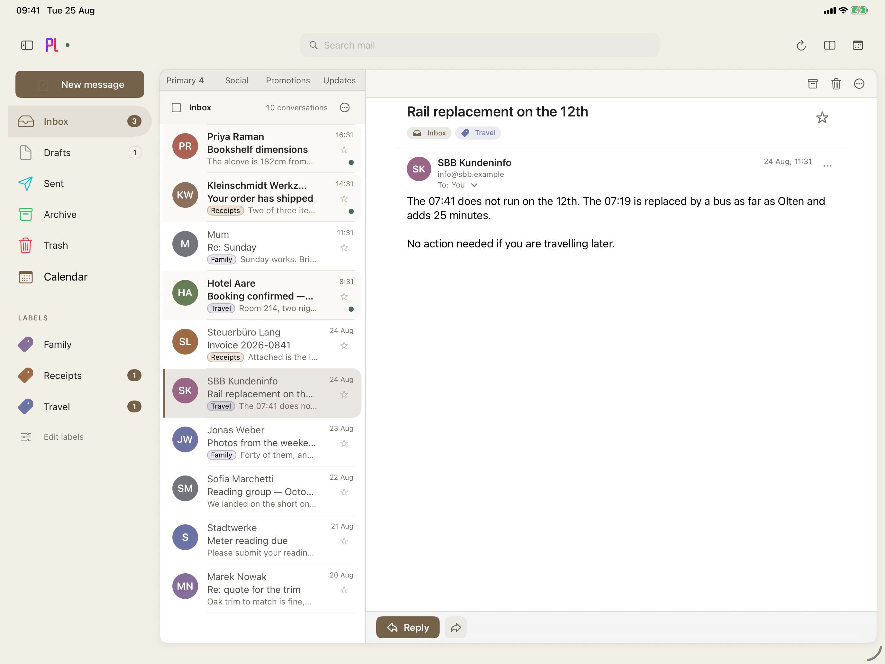
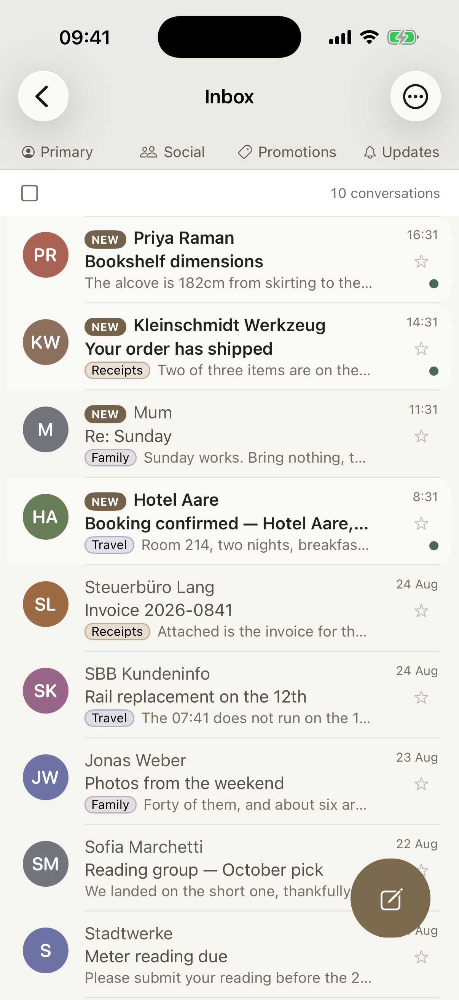
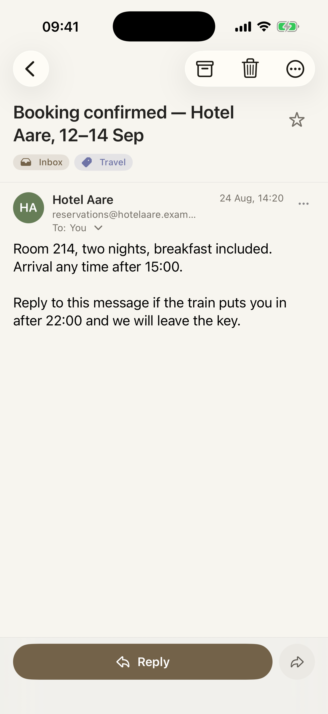
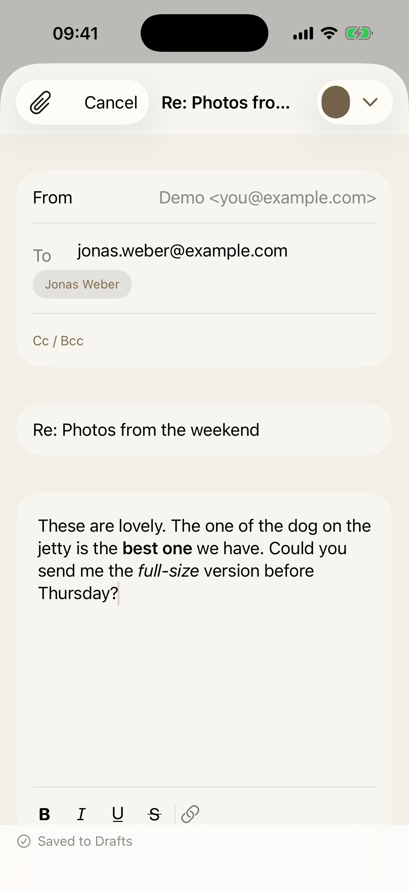
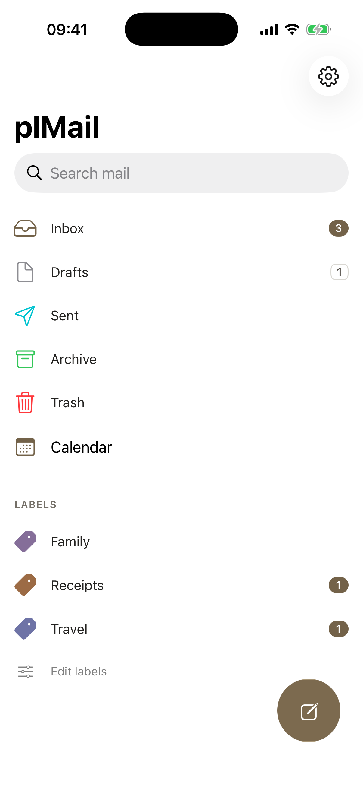
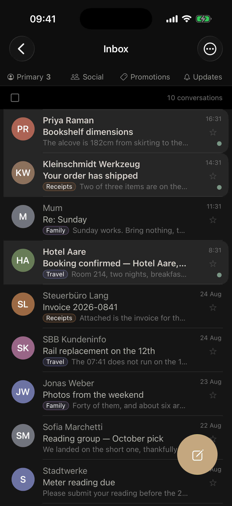
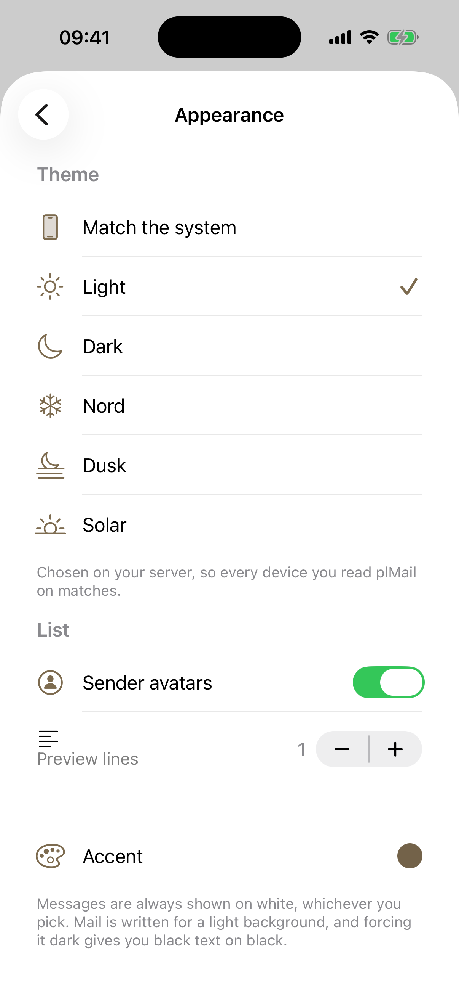
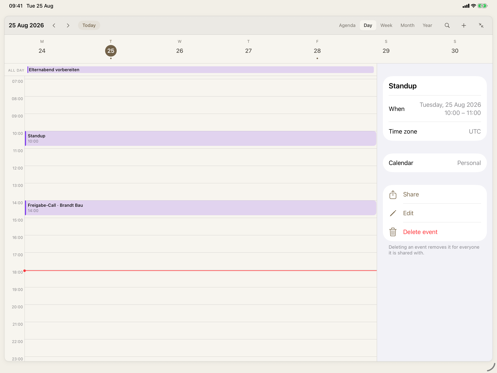

# plMail for iOS

A native iPhone and iPad client for [plMail](https://github.com/karatektus/pl_mail), the self-hosted mail client. Your mail stays on your server; this is the app you read it in.

It talks to plMail directly over **JMAP** — no scraping, no bridge, no account with anyone else in the middle. Pair it once by scanning a code, and every mailbox plMail syncs for you turns up in one inbox.

<p align="center">
  
</p>

---

## What it does

**One inbox, every account.** plMail already pulls your IMAP, Gmail and Outlook mailboxes into one place. The app keeps them that way — a single conversation list in time order, with each account's colour in the sidebar's Accounts legend rather than stamped on every row. Narrowing to one account is something you choose, not the default.

**It works with no signal.** Everything you have already read is on the device, and so is search over it. Open the app on a train, in a lift, in a basement: your mail is there.

**Mail you write does not get lost.** Press send while the server is unreachable and the message is written to disk rather than thrown away. It appears in an Outbox that says plainly what it is waiting for, it survives the app being force-quit, and it goes out on its own once your server is back. Nothing to press, nothing to retype.

**Send it tomorrow morning instead.** Anything you write can be held until later today, tomorrow, next week or a time you pick; it waits in the Outbox, where you can send it now or throw it away. It goes out at the first check after the time you chose — the app has to be open or woken by the system for that, so it may be a little later, and the interface says so rather than pretending to a precision it hasn't got.

**Formatting that survives the trip.** Bold, italic, underline, strikethrough and links, sent as real HTML — so a reply written on your phone reads like one written in the browser, and the quoted thread comes back intact instead of flattened into plain text.

**Reading done properly.** Messages render as the sender wrote them, on white, even when your phone is in dark mode — mail is authored for a light background, and forcing it dark gives you black text on black. Remote images stay blocked until you ask, because in email a remote image is usually a tracking pixel. Attachments open in Quick Look.

**Your calendar, beside your mail.** plMail extracts events out of the mail it syncs — a flight, a delivery, a hotel booking — and the app draws them alongside the ones you typed in yourself. Day, week, month, year and agenda; create, edit and delete; share an event as `.ics`. On a tablet the calendar docks as a third column showing the week ahead, so a booking confirmation and the day it lands on are on screen at the same time. A band above it says what is about to happen and where the app got it from, because an event you did not put there should say so.

**The rest of what you'd expect.** Swipe to archive or delete, with undo. Star, mark read, move between labels. Snooze a conversation until tomorrow morning or a time you pick, and it leaves the inbox and returns unread. Select a dozen messages and act on them at once. Search with the same `from:`, `in:`, `has:attachment` operators as the web UI — matched quirk for quirk, so a query means the same thing in both.

**Recipients complete from your address book** as well as from mail you've already synced, with people you actually write to ranked first. Contacts are read on the device and never leave it, and you're only asked for them the first time you type a recipient — not on first launch.

**Hardware keyboards work.** `c` composes, `r` replies, `e` archives, `s` stars, `⌘N` and `⌘↩` and Escape do the platform-standard things.

**The theme is yours, and it is the server's.** Light, dark, Nord, Dusk, Solar and the rest are chosen once in plMail and served to every client over `Appearance/get` — so the app you read on your phone matches the one in your browser, down to the accent, the density and the corner radius. Nothing here hardcodes a palette. The one place the theme stops is the message itself, which stays on white because mail is written for a light background.

**iPad and German** are not afterthoughts: sidebar, list and reader side by side on a tablet — collapsing to an icon rail when the width runs out — a real back stack on a phone, and the whole interface in either language.

**It works at large text sizes.** At the accessibility sizes the rows restack rather than truncating — a name you can read on two lines beats one you can't on one — and the reply bar drops to icons rather than hyphenating "Re-ply" inside a pill.

---

## Screenshots

| Conversations | Reading | Writing |
|---|---|---|
|  |  |  |

| Mailboxes | A dark theme | Themes |
|---|---|---|
|  |  |  |

<p align="center">
  
</p>

---

## Getting started

### You'll need

- **A plMail server you can reach** — on your LAN, over Tailscale or a VPN, or on the open internet. This is a client; it does not host anything.
- **iOS or iPadOS 26** or later.
- **Xcode 26**, because there is no App Store build. See [Installing](#installing).

### Pairing

In plMail, open **Settings → App passwords → Pair a device**, and scan the code with the app.

That's it. The app takes the address and a freshly issued app password from the code, checks the server is who it claims to be, and shows you which mailbox it found so you can confirm it's the right one before anything is saved.

You can still type the address and paste an app password by hand. But a 71-character secret typed on a phone keyboard is precisely what the QR code exists to spare you.

### Self-signed certificates

If your server presents a certificate your phone doesn't trust — a private CA, a NAS with its own — the app shows you the subject, the issuer, the expiry and a SHA-256 fingerprint, and asks you to accept it once. It's pinned from then on. If that fingerprint ever changes the app stops and tells you, rather than quietly accepting the new one.

Plain `http://` works for a server on your own network, behind a toggle that says in so many words that the connection isn't encrypted.

---

## Installing

No App Store release. Build it yourself:

```bash
git clone https://github.com/karatektus/pl_mail_ios.git
```

Open `plMail.xcodeproj`, pick a simulator, and press Run. Simulator builds need no Apple account at all.

**To put it on your own iPhone or iPad**, follow [docs/INSTALL-ON-DEVICE.md](docs/INSTALL-ON-DEVICE.md). A free Apple ID is enough — no developer programme, no fee. The app is signed for seven days at a time and re-running Xcode renews it.

---

## Privacy

- Mail is fetched **from your server and nowhere else**. No analytics, no crash reporting, no third-party network calls of any kind.
- Your app password is kept in the **iOS Keychain**, marked as non-syncing, so it stays on the one device it was issued to.
- The local database is a **cache** holding nothing that couldn't be fetched again — which is why signing out simply deletes it.
- **Remote images are blocked by default.** Loading one tells the sender you opened their message, roughly when, and roughly from where.
- **Photos you attach lose their GPS tags.** A picture from your library carries the coordinates it was taken at, to a few metres. Blocking tracking pixels while silently sending your address in the other direction would be a strange line to draw.

---

## What isn't there yet

- **No push notifications while the app is closed.** Open, it *is* live: the app holds plMail's JMAP event stream, so a message read in a browser turns up here without anybody pressing anything, and the dot beside the mark in the header says whether that connection is up. Closed is the gap — new mail then arrives when the app next checks, on opening and periodically in the background. The client side is built ([docs/PUSH.md](docs/PUSH.md)); what's missing is an APNs key, which needs a paid Apple developer account, and a sender on the plMail side.
- **The widget needs a paid account too.** It runs in its own process and reads the app's numbers through an App Group, which a free Apple ID cannot grant. It says so rather than showing a zero it can't justify.
- **A few error messages are English-only** even with the app in German. The interface is translated; some failure messages from the networking layer aren't yet.
- **The attachment picker is lightly tested** against unusual document providers, though the photo library and local files both work.
- **No RSVP.** The calendar draws invitations but cannot answer them: `participants` and `myParticipation` are not in the JMAP vocabulary plMail exposes, so Yes / Maybe / No would be three buttons that do nothing. Answering an invitation is a trip to the web UI until the server publishes it — see [docs/parity/03-calendar.md](docs/parity/03-calendar.md) for exactly what it would take.

- **This is a plMail client, not a general JMAP one.** Snooze, cross-account labels, the calendar and search all lean on plMail's own extensions. It won't work against Fastmail or a stock Cyrus server.

---

## What isn't finished

[docs/WHATS-LEFT.md](docs/WHATS-LEFT.md) is the honest list: what is blocked on
a paid Apple account, what is half-built and where, and the handful of traps in
this codebase that cost real time to rediscover.

## Contributing

Issues and pull requests welcome. See [docs/DEVELOPING.md](docs/DEVELOPING.md) for the architecture, the test setup, and the handful of decisions that will look strange until you know why they're there.
